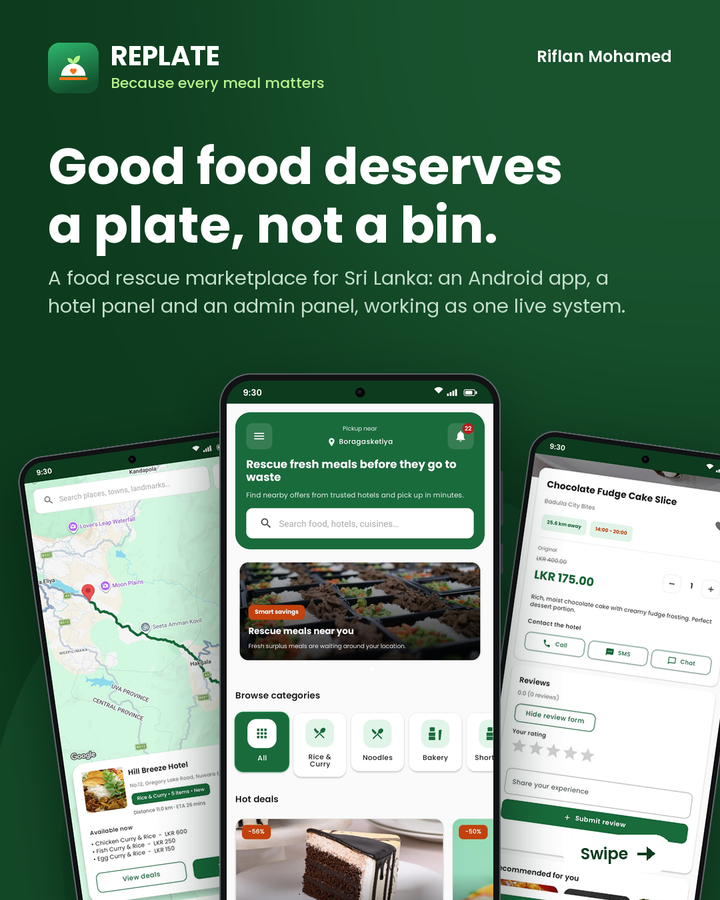
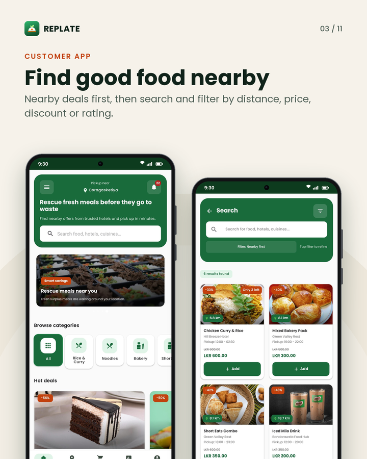
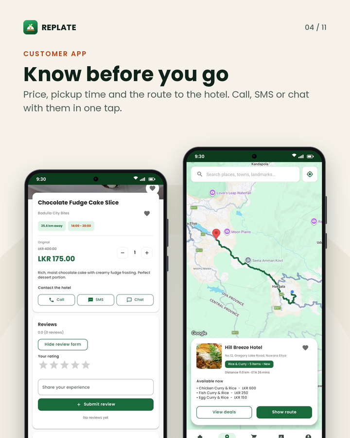
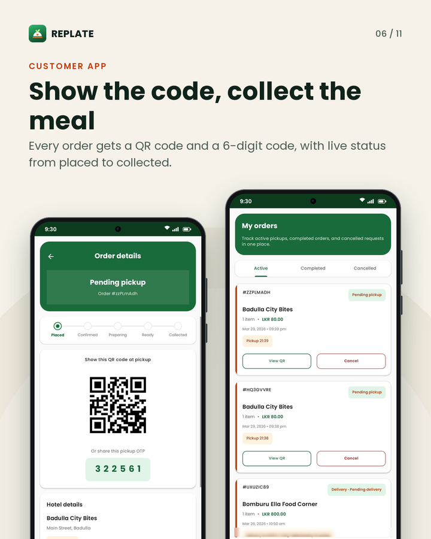

# REPLATE

REPLATE is a food rescue marketplace for Sri Lanka. Hotels and restaurants list the meals they did not
sell at a lower price. Customers find them in an Android app, reserve them, and collect them at the
hotel by showing a QR code or a 6-digit pickup code. Hotels run their side from a web panel, and an
admin panel keeps the platform in check. All three parts share one Firebase backend.

<p align="center">
  
</p>

<table>
  <tr>
    <td align="center" width="33%"><br><sub>Find good food nearby</sub></td>
    <td align="center" width="33%"><br><sub>Dish details and route to the hotel</sub></td>
    <td align="center" width="33%"><br><sub>QR code and 6-digit pickup code</sub></td>
  </tr>
</table>

<table>
  <tr>
    <td align="center" width="50%"><br><sub>Hotel panel</sub></td>
    <td align="center" width="50%"><br><sub>Admin panel</sub></td>
  </tr>
</table>

## How it works

1. **A hotel lists a meal.** The hotel registers on the hotel panel with its business licence. Once an
   admin approves it, it adds dishes with a discounted price, a quantity and a pickup window.
2. **A customer reserves it.** The Android app shows nearby deals in a list, in search and on a map.
   The customer orders for pickup (or delivery) and pays cash or by card through PayHere.
3. **The meal is collected.** The app shows a QR code and a 6-digit code. The hotel scans the QR code
   or types the code in the hotel panel, and the order is marked as completed.

## What is in this repository

| Folder | What it is |
|---|---|
| [`app/`](app/README.md) | Android customer app (Java, Material 3, Firebase, Google Maps) |
| [`web-panels/hotel-panel/`](web-panels/hotel-panel/README.md) | Web panel for hotels: listings, orders, pickup check, chat, analytics |
| [`web-panels/admin-panel/`](web-panels/admin-panel/README.md) | Web panel for the admin: hotel approval, users, listings, reports, notifications |
| [`web-panels/js/`](web-panels/js), [`css/`](web-panels/css), [`assets/`](web-panels/assets) | Shared by both panels: Firebase setup, role checks, UI helpers, order rules, styles, fonts and images. `web-panels/` also holds a public landing page, privacy and terms pages |
| [`firebase-functions/`](firebase-functions/README.md) | Cloud Functions: push notifications, emails, stock updates, pickup reminders, PayHere confirmation |
| [`firebase-rules/`](firebase-rules/README.md) | Realtime Database and Cloud Storage security rules, with an emulator test suite |
| [`scripts/`](scripts) | Node checks for the panels and the functions, and a one-off licence migration |
| [`docs/`](docs) | User manuals, technical guide, design rules, brand files and screenshots |

## Tech stack

| Part | Built with |
|---|---|
| Android app | Java 11, Material 3, min SDK 24 (Android 7.0), target SDK 34, Gradle 8.5 |
| App libraries | Firebase (Auth, Realtime Database, Storage, Cloud Messaging, Crashlytics, Analytics), Google Maps SDK and Directions API, PayHere Android SDK, ZXing, Glide, MPAndroidChart, WorkManager, SQLite |
| Web panels | Static HTML, CSS and JavaScript, Bootstrap 5.3, Firebase JS SDK 9.23 (compat), Chart.js, DataTables, html5-qrcode |
| Backend | Firebase Authentication, Realtime Database, Cloud Storage, Cloud Messaging, Cloud Functions (Node 20, `asia-southeast1`), Nodemailer |
| Quality | JUnit unit tests, Firebase emulator tests, Node checks, GitHub Actions CI |

## Quick start

Prerequisites: [Android Studio](https://developer.android.com/studio),
[Node.js 20 and npm](https://nodejs.org/), the [Firebase CLI](https://firebase.google.com/docs/cli),
and JDK 21 or newer for the emulator tests.

```bash
git clone https://github.com/RizAhd/Replate.git
cd Replate
npm install
```

1. **Firebase project.** Create one and select it with `firebase use <project-id>` (the default in
   `.firebaserc` is `replate-food-rescue`). Turn on Authentication (Email/Password, Google, Facebook,
   Phone), Realtime Database, Storage and Cloud Messaging.
2. **Android app.** Put `google-services.json` in `app/` and add your keys to `local.properties`. See
   [app/README.md](app/README.md#setup).
3. **Web panels.** Create `web-panels/js/env-config.js` with your Firebase web config, then serve
   `web-panels/` on localhost. See [the hotel panel README](web-panels/hotel-panel/README.md#run-locally).
4. **First admin.** In the Realtime Database set `users/<admin uid>/role` to `"admin"`. The account must
   also use one of the admin email addresses. See
   [the admin panel README](web-panels/admin-panel/README.md#how-an-account-becomes-admin).
5. **Deploy the backend**, in this order, because stock is reduced only by a Cloud Function:

   ```bash
   firebase deploy --only functions
   firebase deploy --only database,storage
   ```

   Read [firebase-rules/README.md](firebase-rules/README.md) before deploying the rules, and
   [firebase-functions/README.md](firebase-functions/README.md) for the function settings.

These local config files are git-ignored, so each developer creates their own:
`app/google-services.json`, `local.properties`, `web-panels/js/env-config.js` and
`firebase-functions/.env`.

## Tests

```bash
./gradlew :app:testDebugUnitTest   # Android unit tests (pure Java logic)
npm run rules:test                 # security rules in the Firebase emulator (needs JDK 21+)
npm run web:check                  # every script and local link in web-panels/ parses and resolves
npm run web:test                   # the shared order rules both panels use (revenue, pending, expiry)
npm run functions:test             # Cloud Function decisions (pickup reminders, safe helpers)
npm run stock:test                 # order stock logic against the database emulator
```

`stock:test` needs the function dependencies first: `npm install --prefix firebase-functions`. After
editing `firebase-rules/database.rules.src.js`, run `npm run rules:build` and commit both rule files.

All of these run in GitHub Actions on every push to `master` and on pull requests
(`.github/workflows/ci.yml`).

## Documentation

| Document | For |
|---|---|
| [docs/USER_MANUAL_CUSTOMER.md](docs/USER_MANUAL_CUSTOMER.md) | Customers using the Android app |
| [docs/USER_MANUAL_HOTEL.md](docs/USER_MANUAL_HOTEL.md) | Hotel staff using the hotel panel |
| [docs/USER_MANUAL_ADMIN.md](docs/USER_MANUAL_ADMIN.md) | The platform administrator |
| [docs/TECHNICAL_GUIDE.md](docs/TECHNICAL_GUIDE.md) | Architecture, setup, deployment, tests and where each feature lives |
| [docs/DESIGN.md](docs/DESIGN.md) | Design rules: type, spacing and colour tokens |
| [docs/IMAGE_CREDITS.md](docs/IMAGE_CREDITS.md) | Credits for the bundled photos |
| [firebase-rules/README.md](firebase-rules/README.md) | Who can read and write what, and how to deploy the rules |

Logo files in SVG and PNG are in [`docs/brand/`](docs/brand).

## Security notes

- Anything compiled into an APK can be extracted, so server keys and the PayHere merchant secret stay
  out of the app. The merchant secret belongs only in the `payhereNotify` function's environment.
- Restrict the Google Maps key to this app (package name and SHA-1) and to the Maps SDK and Directions
  API, and set a billing alert in Google Cloud Console.
- A debug build only runs against the PayHere sandbox and refuses a live merchant ID (one starting
  with 2).

## Known gaps

- Pickup codes are created on the phone at checkout, not on the server.
- Customers can read each hotel's phone, email and push token from the `hotels` node, which the map
  needs. These private fields should move to their own node.
- The app is English only, light theme only and portrait only.
- Delivery has no live courier tracking.

## Contributing

Issues and pull requests are welcome. For a large change, open an issue first. Keep commits small and
make sure the tests above pass.

## License

No open-source licence has been added yet, so all rights are reserved by the owner.

## Author

**Riflan Mohamed** ([GitHub: RizAhd](https://github.com/RizAhd))
