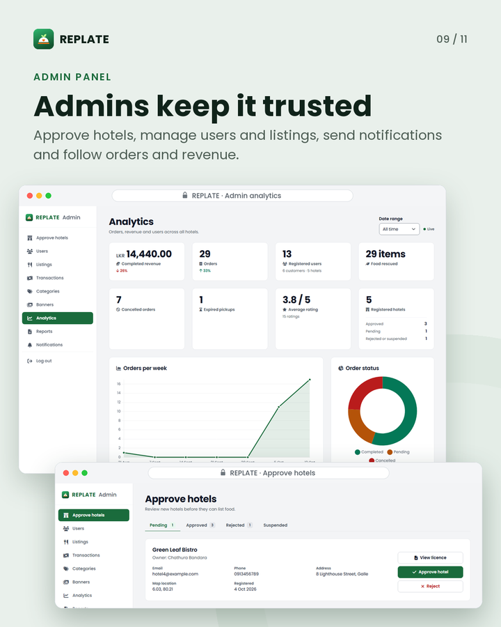

# REPLATE admin panel

The web panel for the platform administrator: approve hotels, manage users and listings, run the app's
categories and banners, send notifications, and follow orders and revenue across all hotels. It is
static HTML, CSS and JavaScript that talks to Firebase directly.

[Back to the main README](../../README.md) · [Admin user manual](../../docs/USER_MANUAL_ADMIN.md)

  

## Pages

| Page | What it is for |
|---|---|
| `login.html` | Admin sign-in with email and password; only the admin addresses are accepted; forgot password |
| `approve-hotels.html` | Pending, Approved, Rejected and Suspended tabs; view a hotel's licence; approve, or reject with a reason |
| `users.html` | Every customer and hotel account; search and filter by role and status; suspend or enable; export CSV |
| `listings.html` | Every dish hotels have published; hide or show it without deleting, or delete it; export CSV |
| `transactions.html` | Every order and payment across all hotels, with a date filter; export CSV |
| `categories.html` | The category chips customers see in the app: add, rename, reorder, delete |
| `banners.html` | Photo banners at the top of the app's Home screen: title, subtitle, badge, tap action, optional start and end dates |
| `analytics.html` | Orders, revenue and users across all hotels for a date range, with charts and a per-hotel table |
| `reports.html` | Hotel performance, cancelled and expired orders, and reviews; every table exports to CSV |
| `notifications.html` | Platform activity; send a broadcast, a push to chosen users or a deal notification; the log of sent notifications |

After signing in, the admin lands on `approve-hotels.html`. Suspending a user and sending notifications
call Cloud Functions, so those need the functions deployed and `FUNCTIONS_BASE_URL` set in
`env-config.js`.

## How an account becomes admin

Two things are both required: the account's **role** is `admin` **and** it signs in with one of the
two **admin email addresses**, `admin@replate.com` or `superadmin@replate.com`.

1. Create an email and password user with one of those addresses in Firebase Authentication.
2. In the Firebase console, open the Realtime Database and set `users/<that uid>/role` to `"admin"`.
3. Sign in on `admin-panel/login.html`.

No client can grant the role. The database rules let a user choose `customer` or `hotel` once, at
sign-up, and only an admin can change it after that, so step 2 has to be done in the console.

Where the check lives:

| Place | What it checks |
|---|---|
| `admin-panel/login.html` | Refuses to sign in an address that is not in `ReplateUI.ADMIN_EMAILS` |
| `web-panels/js/ui-shell.js` | `ADMIN_EMAILS`; `ReplateUI.requireRole('admin')` on every admin page needs the role and the address, otherwise it signs the user out and says why |
| `firebase-rules/database.rules.src.js` | The `ADMIN` expression: role `admin` and `auth.token.email` is one of the two addresses |
| `firebase-rules/storage.rules` | `isAdmin()`: the address only, because Storage rules cannot read the database |
| `firebase-functions/index.js` | `ADMIN_EMAILS`; admin-only functions need the admin role and the address |

To change the admin addresses, edit all four lists, run `npm run rules:build` and `npm run rules:test`,
then redeploy the rules, the functions and the panels.

Admin accounts cannot be suspended from the Users page, and an admin cannot suspend their own account.

## Run locally

Set up `web-panels/js/env-config.js` and serve the `web-panels/` folder exactly as described in
[the hotel panel README](../hotel-panel/README.md#run-locally), then open
`http://localhost:8080/admin-panel/login.html`.

## Shared code

The admin pages use the same shared files in `../js/` as the hotel panel (`firebase-config.js`,
`ui-shell.js`, `data-schema.js`, `notifications-api.js`), plus `admin-shell-config.js` for the sidebar
links. The users, listings and transactions tables use DataTables, and the analytics charts use
Chart.js, both loaded from a CDN.
