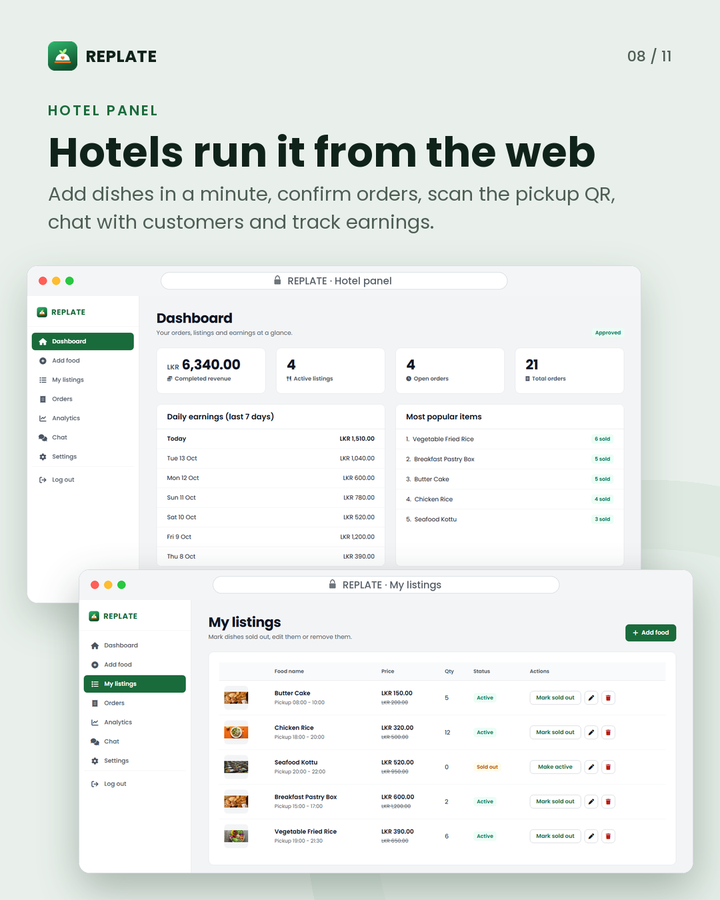

# REPLATE hotel panel

The web panel hotels and restaurants use to list surplus meals, handle orders and hand them over at
pickup. It is static HTML, CSS and JavaScript that talks to Firebase directly.

[Back to the main README](../../README.md) · [Hotel user manual](../../docs/USER_MANUAL_HOTEL.md)

<p align="center">
  
</p>

## Pages

| Page | What it is for |
|---|---|
| `login.html` | Sign in with email and password, Google or Facebook; forgot password |
| `register.html` | Register a hotel: name, owner, contact details, address, map location and business licence |
| `dashboard.html` | Completed revenue, active listings, open orders, daily earnings for the last 7 days, most popular items and recent orders |
| `add-food.html` | Add a discounted dish: name, category, description, original and discounted price (LKR), quantity, pickup window and photo |
| `manage-listings.html` | My listings: mark a dish sold out or active again, edit it, replace its photo or delete it |
| `orders.html` | Active and History tabs with search; move each order to its next step; hand it over by scanning the customer's QR code or typing the 6-digit pickup code |
| `analytics.html` | Revenue, orders by status, best-selling dishes and orders per day for the last 14 days |
| `chat.html` | Conversations with customers |
| `settings.html` | Hotel profile (name, owner, phone, address) and new-order alerts (browser notifications and a sound) |

## What a hotel does

1. **Register** on `register.html`. The hotel is saved as `pending` and the owner is signed out until an
   admin approves it. The licence goes to Storage and its link to `hotelLicenses/`, which only the owner
   and admins can read.
2. **Add dishes** once approved. Each dish has a price, a quantity and a pickup window, and appears in
   the app straight away.
3. **Handle orders.** Pickup orders go Confirm, Preparing, Ready, then hand over. Delivery orders go
   Confirm, Preparing, Dispatch, Delivered. Each status change sends the customer one push from a Cloud
   Function.
4. **Hand over** a pickup order by scanning the QR code with the camera (html5-qrcode) or typing the
   6-digit code. The panel refuses a code once the customer's one-hour pickup slot has ended and marks
   the order "Slot ended"; the hotel can still complete it with the order's Done button.
5. **Follow up** with customers in Chat, and watch revenue on the Dashboard and Analytics pages.

## How sign-in works

- `login.html` signs in with Firebase Authentication (email and password, or a Google or Facebook
  pop-up), then looks up the hotel that belongs to the account.
- Only an **approved** hotel reaches the dashboard. A pending, rejected or suspended hotel sees a notice
  (with the rejection reason, if any) and is signed out. An account with no hotel is told to register
  first.
- The panel pages call `ReplateUI.requireRole('hotel')` from `../js/ui-shell.js`, which checks
  `users/<uid>/role`. `orders.html`, `manage-listings.html`, `chat.html` and `analytics.html` also call
  `ReplateUI.requireApprovedHotel()`.
- These checks only hide the interface. The real protection is the database rules in
  [`firebase-rules/`](../../firebase-rules/README.md): an unapproved hotel cannot create listings or
  change orders.

## Run locally

1. Create `web-panels/js/env-config.js` (it is git-ignored). Every page loads it before
   `js/firebase-config.js`:

   ```js
   const ENV = Object.freeze({
       FIREBASE_API_KEY:          '...',
       FIREBASE_AUTH_DOMAIN:      '...',
       FIREBASE_DATABASE_URL:     '...',
       FIREBASE_PROJECT_ID:       '...',
       FIREBASE_STORAGE_BUCKET:   '...',
       FIREBASE_MESSAGING_SENDER: '...',
       FIREBASE_APP_ID:           '...',
       FUNCTIONS_BASE_URL:        'https://asia-southeast1-<project>.cloudfunctions.net'
   });
   ```

   The Firebase values come from your Firebase project's web app settings.

2. Serve the whole `web-panels/` folder (not just this one, because the pages load `../js`, `../css`
   and `../assets`) with any static server, for example:

   ```bash
   cd web-panels
   python -m http.server 8080
   ```

3. Open `http://localhost:8080/hotel-panel/login.html`, or `http://localhost:8080/` for the landing
   page.

Use `localhost` rather than opening the files from disk: Google and Facebook sign-in only work on a
domain listed under Firebase Authentication > Settings > Authorized domains.

To publish the panels, `firebase deploy --only hosting` uploads `web-panels/` (set as the hosting
folder in `firebase.json`).

## Shared code

| File | Role |
|---|---|
| `../js/firebase-config.js` | Starts Firebase from `env-config.js`; sends signed-out visitors to `login.html` |
| `../js/ui-shell.js` | `ReplateUI`: role checks, sidebar, toasts, dialogs, form errors, image compression, new-order alerts |
| `../js/hotel-shell-config.js` | The hotel sidebar links |
| `../js/data-schema.js` | `ReplateSchema`: order and hotel status rules, revenue and pickup expiry |
| `../js/notifications-api.js` | Calls the HTTPS Cloud Functions with the signed-in user's token |

Check the pages with `npm run web:check` and the shared order rules with `npm run web:test` (from the
repository root).
